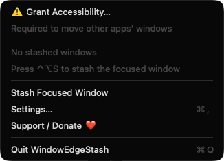
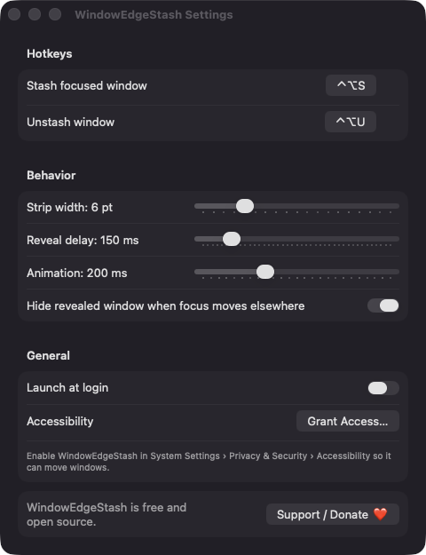

# WindowEdgeStash

**🌐 Website:** [turhe123.github.io/window-edge-stash](https://turhe123.github.io/window-edge-stash/)

Park any window at a screen edge where it slides out when your pointer touches that edge.

> 🆓 A free, open-source **Rectangle Pro alternative** for macOS 14+. Native Swift, no accounts, no subscriptions, MIT licensed.


## Why

WindowEdgeStash is a free, open-source, 100% native, backend-free alternative to paid utilities in the *Window Management* category. The edge-stash idea was inspired by Rectangle Pro ($9.99 one-time); this app is a clean-room, focused tool that does just that one thing. There is no server, no account and no analytics, and it runs entirely on your Mac.

## Features

- **Stash the focused window** with a global hotkey (default `⌃⌥S`). The window moves to the nearest free screen edge (left, right or bottom) and leaves a thin strip visible.
- **Slide-out on hover**: rest the pointer on the strip for the configured delay and the window slides fully into view, raised and focused.
- **Slides back** when the pointer leaves, and optionally when focus moves to another app. Focus returns to the app you were using before.
- **Unstash** with a second hotkey (default `⌃⌥U`) or from the menu. The window returns to its original position and size.
- **Multiple windows per edge**, with strips stacked so each one has its own hover area.
- **Multi-display aware**: edges that border another display are skipped.
- **Edge highlight**: a subtle line appears on the screen edge while the pointer hovers a strip.
- **Menu bar app** (no Dock icon): lists stashed windows by app and title, each with Unstash, plus Unstash All, Stash Focused Window, Settings, Support and Quit. An empty state shows a hotkey hint.
- **Settings**: recordable hotkeys, strip width (2–20 pt), reveal delay (0–1000 ms), animation duration (0–600 ms), hide on focus loss, launch at login.
- **Robust handling**: windows of closed or quit apps are dropped, windows the system clamps on screen get a retry, WindowEdgeStash's own windows and full-screen windows are refused, the pointer monitor pauses briefly during Space changes, and all windows are unstashed on display changes and when the app quits.

The stash list lives only in memory. Window references can't survive a quit, so every stashed window is restored when you quit the app.

## Screenshots

<p align="center"></p>

<p align="center"><em>The WindowEdgeStash menu bar menu with the stash hotkey hint, Stash Focused Window, Settings and Support actions.</em></p>

<p align="center"></p>

<p align="center"><em>Settings for recordable hotkeys, strip width, reveal delay, animation speed, focus-loss hiding and launch at login.</em></p>

## Install

1. Download `WindowEdgeStash-macOS.zip` from https://github.com/turhe123/window-edge-stash/releases/latest
2. Unzip it and move `WindowEdgeStash.app` to `/Applications`.
3. Because the app is open source and not notarized, clear the quarantine flag:

   ```bash
   xattr -cr /Applications/WindowEdgeStash.app
   ```

4. Right-click the app and choose **Open** the first time you launch it.

## Build from source

Requires macOS 14+ and Xcode with Swift 5.9+.

```bash
brew install xcodegen
xcodegen generate
xcodebuild -project WindowEdgeStash.xcodeproj -scheme WindowEdgeStash -configuration Release -derivedDataPath ./build build
```

The app is produced at `build/Build/Products/Release/WindowEdgeStash.app`.

## Permissions

- **Accessibility** (required): used to read and move other apps' windows and to detect the focused window. The app prompts on first launch, and the menu and Settings show a "Grant Accessibility" action until it is enabled. Enable it in System Settings › Privacy & Security › Accessibility.
- **Launch at login** (optional): registered through `SMAppService` only when you turn the toggle on.

The app does **not** request Screen Recording, Microphone, Camera or network access, and it doesn't capture window contents or keystrokes. Global hotkeys use Carbon `RegisterEventHotKey`, and pointer tracking uses a global mouse-moved monitor plus a 30 Hz poll of the pointer position.

## Built with AI

WindowEdgeStash was written by [Claude Code](https://claude.com/claude-code) inside an automated pipeline, from a plain-English spec. No code, binaries or assets from any commercial app were used; it is a clean-room reimplementation of a feature set, not a copy.

What that means in practice:

- The full source is in this repo under the MIT license. Read it before you run it.
- No network calls, no analytics, no third-party dependencies. Only Apple frameworks.
- Ad-hoc signed and not notarized, which is why Gatekeeper warns on first launch.
- It has had less human review than a hand-written app. Bug reports and pull requests are welcome.

## Support ❤️

WindowEdgeStash is free. If it's useful to you, you can support its development:

[Support Or (Leo) Davidai ❤️ on Ko-fi](https://ko-fi.com/leodavidai)

## More free Mac apps

WindowEdgeStash is one of a growing collection of [free, open-source Mac utilities](https://github.com/turhe123/mac-apps) built the same way: native Swift, no accounts, no telemetry. Browse the full gallery at [turhe123.github.io/mac-apps](https://turhe123.github.io/mac-apps/).

Prefer something that runs in the browser? The same pipeline builds [free, private web tools](https://turhe123.github.io/web-tools/): PDF, image, developer, data and audio tools, nothing uploaded.

## License

MIT © Or Davidai Bachar
